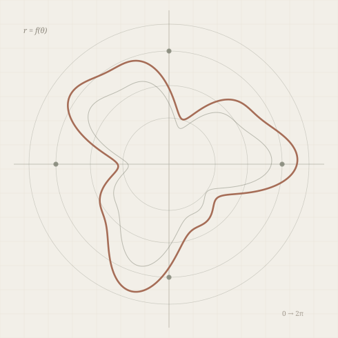

# An Academic Notebook

A complete, typography-first personal website for mathematical essays and research notes. Authored in **Quarto**, styled with custom CSS/SCSS, with LaTeX mathematics, equation numbering, citations, responsive layout, searchable content, and a GitHub Pages–friendly output directory.



## What's included

- **Home**: editorial introduction, original mathematical SVG illustration, and automatically updated recent writing.
- **Essays**: archive of long-form work; two substantive example essays.
- **Notes**: shorter derivations; two example notes.
- **About**: a biographical page that you can replace with your own details.
- **Mathematics**: LaTeX in `$...$` and `$$...$$`, MathJax in the Quarto build, numbered equations, proof environments, theorem-like blocks, and references.
- **Search**: Quarto's built-in website search in the generated Quarto edition. The separately rendered HTML example under `docs/` also contains a lightweight, local search dialog (keyboard shortcut Ctrl/Cmd+K).
- **Publishing**: pre-rendered HTML in `docs/` for immediate viewing and GitHub Pages deployment.

> **Important:** "Your Name", the About page, all dates and sample articles are illustrative placeholders. Replace them before publishing your own personal website.

## Quick start with Quarto

1. Install Quarto from <https://quarto.org/docs/get-started/> (tested against the Quarto 1.x project syntax; recommended current stable version).
2. Open a terminal in the directory containing `_quarto.yml`.
3. Preview the actual Quarto project:

   ```bash
   quarto preview
   ```

4. Render the site to `docs/`:

   ```bash
   quarto render
   ```

   **Note:** Quarto overwrites the supplied pre-rendered `docs/` edition. That is expected; `quarto render` is the authoritative build and adds its standard navigation, site search, RSS feed, and cross-references.

You can also view the **pre-rendered example without installing Quarto** by opening `docs/index.html`. For a local web-server preview:

```bash
python -m http.server 8000 --directory docs
```

Then visit `http://localhost:8000`.

## Make it yours

Edit the following first:

1. `_quarto.yml`: change `website.title` and footer copyright; replace `website.site-url: https://example.com/` with your final URL (mandatory for correct RSS and canonical URLs).
2. `index.qmd`: change the introduction, topic labels, and call to action.
3. `about.qmd`: write your biography and replace the placeholder contact wording.
4. `styles/site.css`: modify `--paper`, `--ink`, `--accent`, typography, and component styles.
5. `assets/favicon.svg`: replace the ∑ monogram if desired.
6. Replace or remove the four example `.qmd` articles under `essays/` and `notes/`.

The CSS imports Newsreader and DM Sans from Google Fonts with local fallback fonts. Remove the first `@import` line in `styles/site.css` if you prefer to avoid loading remote font resources.

## Write a new mathematical article

Copy `templates/new-essay.qmd` to a descriptive filename under `essays/`, such as `essays/spectral-theorem.qmd`. Set the front matter and remove `draft: true` when ready to publish.

Inline math:

```markdown
For $f \in L^2(\mathbb R)$, its Fourier transform is $\widehat f$.
```

Display math with an equation label:

```markdown
$$
\int_{-\infty}^{\infty} e^{-x^2}\,dx = \sqrt{\pi}.
$$ {#eq-gaussian}

As shown in @eq-gaussian, ...
```

A numbered theorem:

```markdown
::: {#thm-sample .theorem}
Every continuous real-valued function on a nonempty compact space
attains its minimum and maximum.
:::

By @thm-sample, ...
```

Citations work with BibTeX keys in `references.bib`:

```markdown
See [@stein2003fourier] for background on Fourier analysis.
```

New files appear automatically in their section's listing and in the homepage's recent writing block.

## Deploy on GitHub Pages

The easiest approach is deployment from a branch:

1. Create a public or private GitHub repository according to your plan's Pages availability.
2. Commit the project, including the `docs/` directory, and push it to the `main` branch.
3. On GitHub, open **Settings → Pages → Build and deployment**. Choose **Deploy from a branch**, branch `main`, folder `/docs`, then save.
4. Set `website.site-url` in `_quarto.yml` to the final GitHub Pages address (`https://USERNAME.github.io/REPOSITORY/`) or your custom domain, and run `quarto render` again.
5. Commit and push the updated `_quarto.yml` and `docs/` output.

The project contains a `.nojekyll` file, copied into `docs/`, which prevents Jekyll from unexpectedly processing Quarto assets.

Official publishing guide: <https://quarto.org/docs/publishing/github-pages.html>

## Repository map

```text
academic-notebook/
├── _quarto.yml             # Quarto site configuration
├── index.qmd               # Custom editorial homepage
├── about.qmd               # Biography
├── essays/
│   ├── index.qmd           # Automatically populated essay archive
│   ├── fourier-series.qmd
│   └── compactness.qmd
├── notes/
│   ├── index.qmd
│   ├── euler-identity.qmd
│   └── gaussian-integral.qmd
├── references.bib          # BibTeX bibliography
├── styles/
│   ├── theme.scss          # Quarto/Bootstrap variables
│   └── site.css            # Main design system and layouts
├── assets/                 # Original mathematical SVG artwork
├── templates/
│   └── new-essay.qmd
├── tools/
│   ├── create_art.py       # Re-generates SVG sample illustrations
│   └── render_static.py    # Creates a separate no-Quarto HTML example
└── docs/                   # Ready-to-browse published site
```

The pre-rendered HTML edition (`docs/`) is built by `tools/render_static.py` using Pandoc, Python, PyYAML, and BeautifulSoup. You do **not** need to run that script for normal Quarto work; it is included for reproducibility of the immediately viewable edition.

## Design and accessibility

- Warm paper background, near-black ink, earthy accent, editorial serif typography.
- Clear focus styles and semantic navigation; mobile navigation and reduced-motion support.
- Original SVG illustrations, with alternative text.
- Mathematical notation in the included HTML edition is pre-rendered to native **MathML** by Pandoc, so it does not need a JavaScript math-rendering library. The Quarto build uses **MathJax** for authoring flexibility.

This is a static site: no database, server-side code, or paid hosting is needed for the basic functionality.
