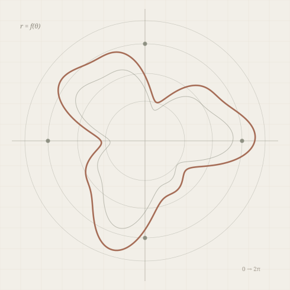

  <section class="hero-band" aria-label="Introduction">
    

      
 A PERSONAL MATHEMATICAL NOTEBOOK

      <h1>Some ideas deserve <em>a longer proof.</em></h1>
      
An evolving collection of mathematical essays, patient explanations, and notes from the margins of a notebook.

      

        <a class="btn-ink" href="essays/index.html">Explore essays &nbsp; ↗</a>
        <a class="text-link" href="about.html">A little about this space</a>
      

    

    

      
      
FIG. 01 — NOTES ON STRUCTURE∴

    

  </section>
  

  

    01 &nbsp; <b>Analysis &amp; geometry</b>
    02 &nbsp; <b>Proofs &amp; intuition</b>
    03 &nbsp; <b>Mathematical notes</b>
  

  

  <section class="section-head">
    

      
THE JOURNAL

      <h2>Recently on paper</h2>
    

    <a href="essays/index.html">Browse the archive ↗</a>
  </section>

::: {#recent-writing .landing}
:::

  <section class="note-band">
    

      
A NOTE ON THE PROCESS

      <h2>Curiosity, before certainty.</h2>
      
Mathematics becomes memorable when the argument has room to breathe. These pages are for that slower kind of thinking.

      <a class="text-link" href="notes/index.html">Read the working notes ↗</a>
    

    
eiπ + 1 = 0

  </section>

