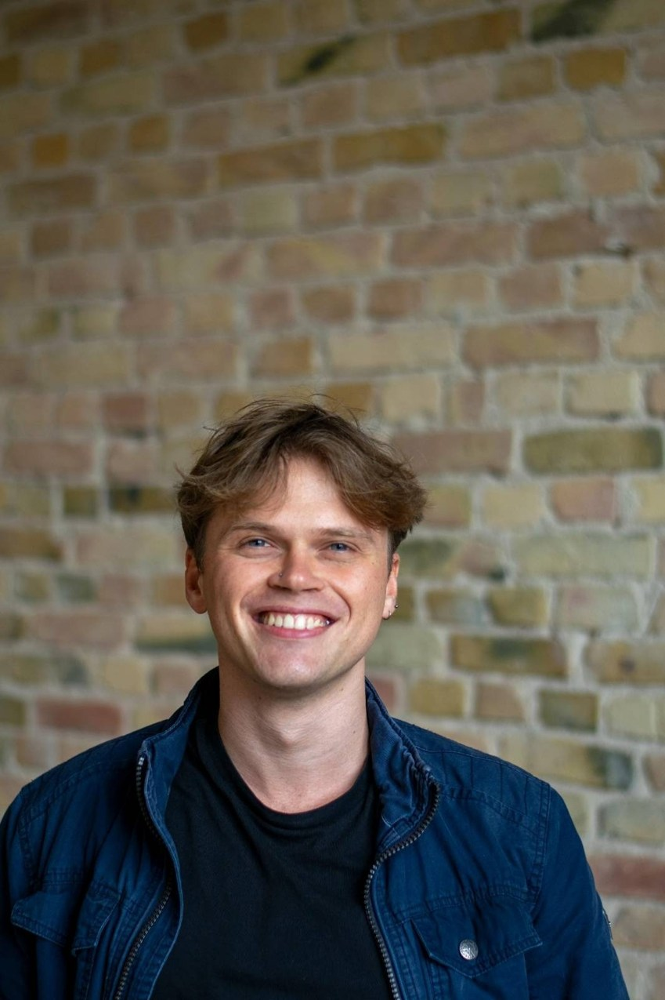

```{=html}
<div class="intro"><div class="welcome"><h1>Welcome to my website.</h1><p>My name is <strong>Amjad Saef</strong>. On this website, you can find information about my current and past endeavours, and in particular some more or less formal essays on intelligence and computation.</p></div>

<p class="bio">I am a mathematician by training and a programmer by vocation. In July 2026, I defended my dissertation, written under the supervision of Prof. Dr. Wilhelm Stannat at TU Berlin and the Berlin Mathematical School. Subsequently, I joined Danial Saef and Mohammad El-Ismail in co-founding <a href="https://scrg.io/">Scrooge</a>, a platform to track and act on risks and opportunities in digital asset markets.</p></div>
```

::: {.latest}
<div class="section-head"><h2>Latest essay</h2><a class="secondary" href="blog.html">All posts</a></div>

::: {.post-list limit="1"}
:::
:::
